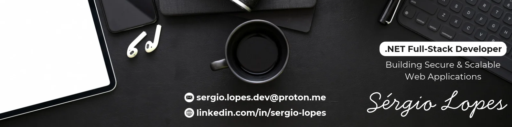

  

## Hi there 👋

I'm Sérgio, a Computer Engineer with professional experience building .NET applications. I enjoy designing maintainable software using Clean Architecture, Domain-Driven Design (DDD), and CQRS, with a focus on building well-tested, well-documented, and production-ready applications.

### Currently building

**[WhoAmI](https://github.com/sergio-lopes-developer/whoami)** — A portfolio project showcasing modern .NET architecture, software engineering practices, and technical documentation.
